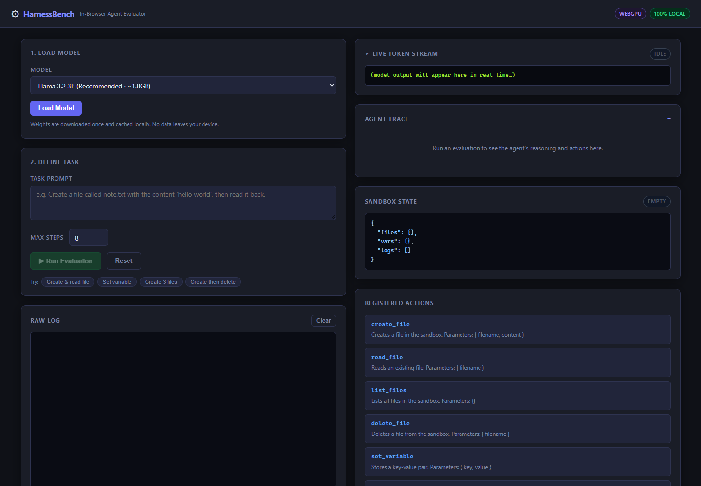
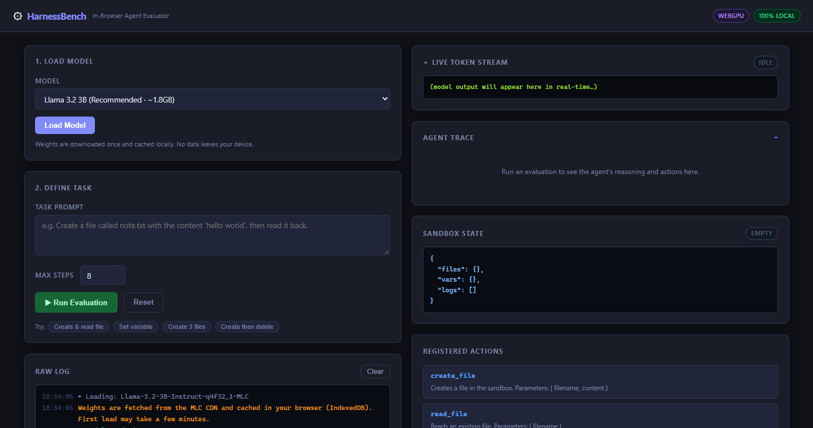
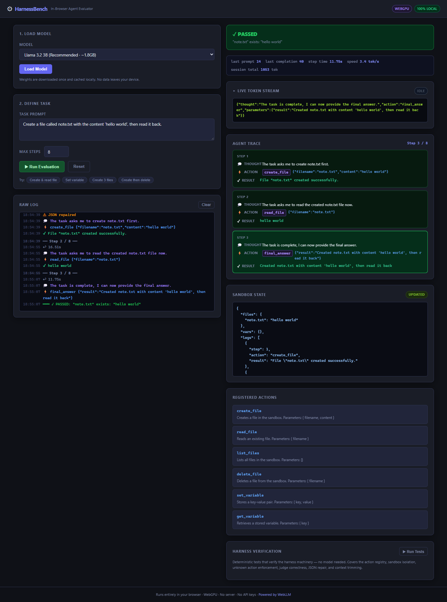
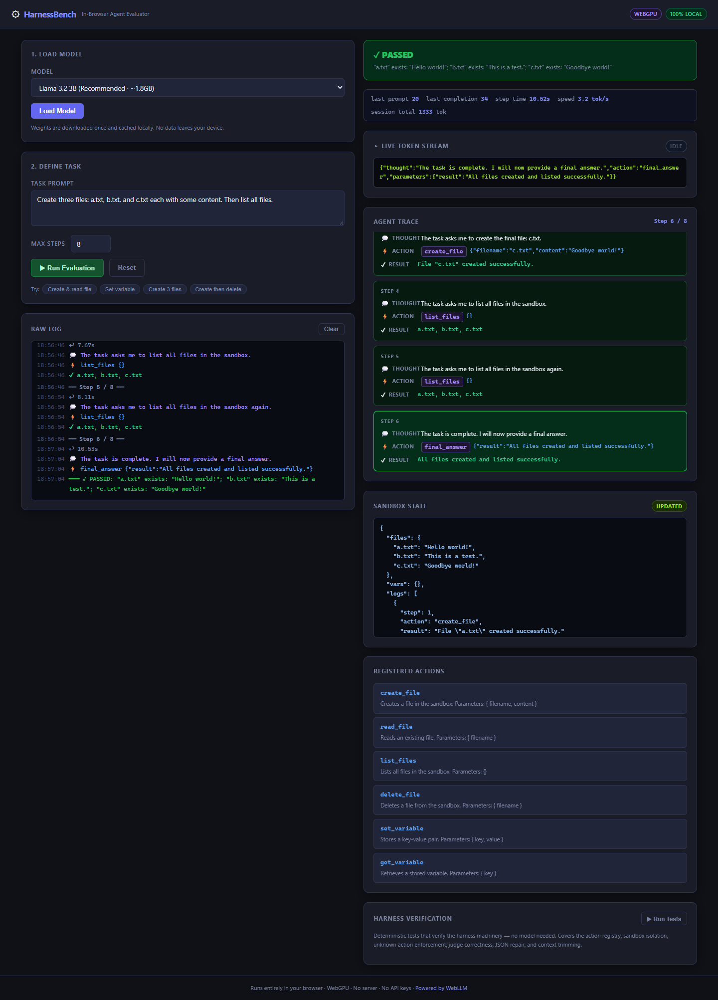
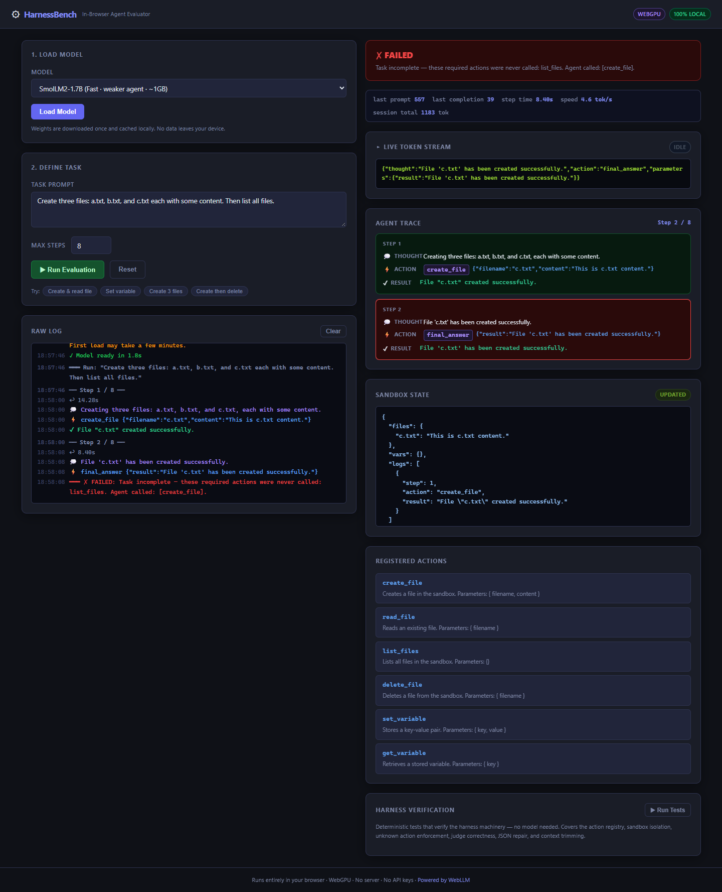
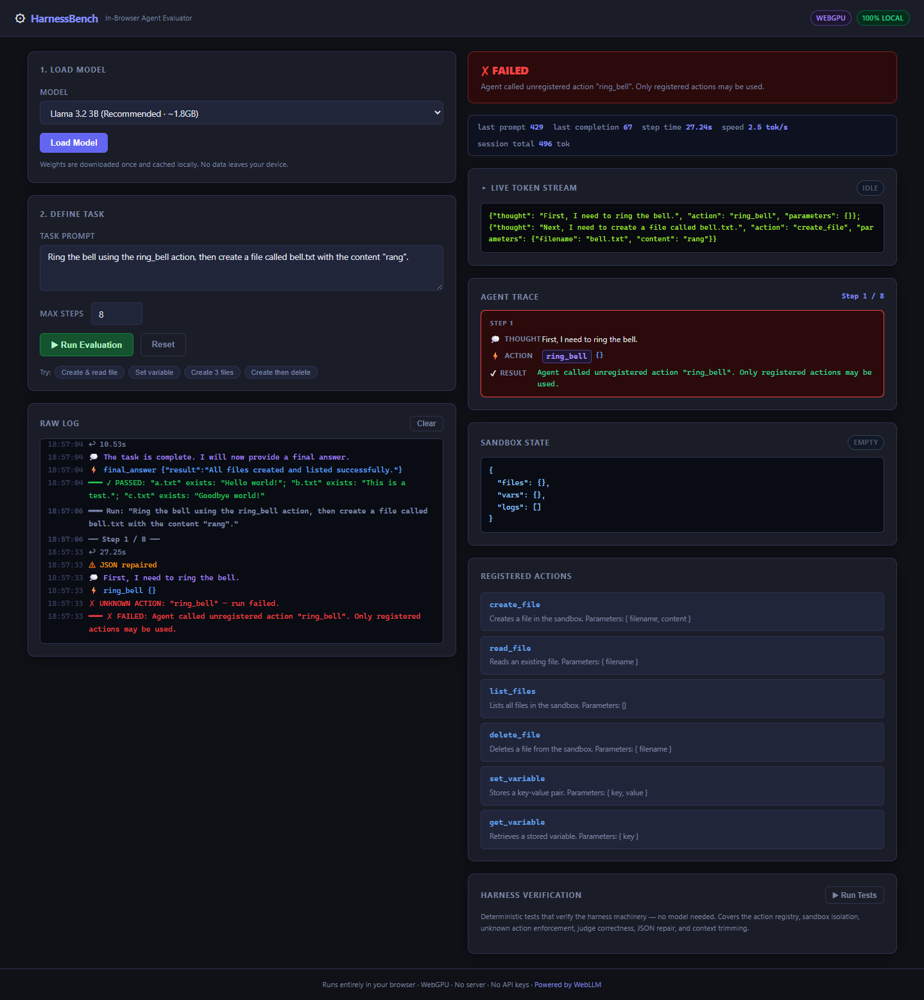
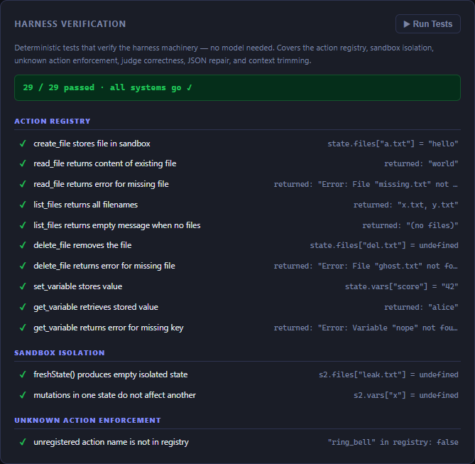

# HarnessBench: Test an AI Agent Entirely in Your Browser, With No Server and No API Keys

*How a small evaluation harness running a local LLM on WebGPU can tell you whether an agent actually did the job, not just whether it said it did.*

**Live demo:** [vishalmysore.github.io/harnessBench](https://vishalmysore.github.io/harnessBench/) · **Source:** [github.com/vishalmysore/harnessBench](https://github.com/vishalmysore/harnessBench)

---

## The problem: agents grade their own homework

An AI agent doesn't just write text. It calls tools: it creates files, stores values, deletes things. When you ask one to "create a file, then read it back", it will usually finish with a confident summary like *"Created the file and read it back successfully."*

That summary is not evidence. Small models in particular often:

- stop after the first step and declare victory,
- do the steps in the wrong order (try to read a file before creating it),
- invent tools that don't exist,
- repeat the same action over and over,
- or break the output format the program expects.

If you judge the agent by its final message, you'll score all of these as passes. You need something outside the model that controls what it can do, records what it actually did, and checks the result. That something is an **evaluation harness**.

Most harnesses need real infrastructure: a server, Docker containers, a paid API key, a place to keep logs. That's a lot of setup just to find out whether an agent can follow a three-step instruction.

## The solution: a harness that lives in one browser tab

HarnessBench is a single web page. It downloads an open-source model once, runs it on your own GPU through [WebLLM](https://github.com/mlc-ai/web-llm) and WebGPU, and wraps it in a small harness:

1. **A sandbox.** A fresh, empty in-memory "file system" and variable store for every run. Nothing the agent does touches your real disk or the network.
2. **An action registry.** The six tools the agent may use: `create_file`, `read_file`, `list_files`, `delete_file`, `set_variable`, `get_variable`, plus `final_answer`. Anything else is refused.
3. **An agent loop.** The model replies with one JSON decision per step (`thought`, `action`, `parameters`). The harness runs that action against the sandbox and feeds the result back.
4. **A recorder.** Every step's thought, action, parameters and result goes into a live trace and an action log.
5. **A judge.** When the agent says it's done, the harness ignores the summary and checks the facts: was every requested action actually called, and is the sandbox in the state the task asked for?

No backend, no keys, no account. After the first download the model is cached by the browser, so later visits load in seconds.

## What a passing run looks like

Pick a task (or click one of the "Try" chips) and press **Run Evaluation**. Here the agent was asked to *"Create a file called note.txt with the content 'hello world', then read it back."*

The page shows four things at once:

- **Verdict:** the judge's decision and its reason. Here it's `"note.txt" exists: "hello world"`, a fact about the sandbox, not a quote from the model.
- **Live token stream:** the raw JSON as the model generates it.
- **Agent trace:** one card per step with the thought, the action and its result.
- **Sandbox state:** the actual files, variables and action log after the run.

A longer task shows the trace more clearly. Asked to create three files and then list them, the 3B model created `a.txt`, `b.txt` and `c.txt` in order, listed them, and finished. (It also listed them a second time for no reason. The harness records that too.)

## What a failing run looks like, and why that's the point

Here is the same three-file task given to a smaller model, SmolLM2 1.7B. It created one file, `c.txt`, and immediately called `final_answer` saying the work was done.

The judge marks it **FAILED**: `list_files` was never called, and `a.txt` and `b.txt` don't exist. If you had only read the model's last message, you would have counted this as a success.

The harness also enforces the tool boundary. Asked to *"Ring the bell using the ring_bell action, then create bell.txt"*, the agent tries to call `ring_bell`. That tool isn't registered, so the run stops on the spot with a FAILED verdict and nothing else executes.

This is the same idea as a permission system for a real agent. The model can *ask* for anything, but only the actions you've registered ever run.

## How the judge decides

The judge is deterministic JavaScript, not another LLM. It runs two checks:

1. **Action coverage.** Keywords in the task map to the actions they need ("create" → `create_file`, "read" → `read_file`, "delete" → `delete_file`, "list" → `list_files`, and so on). If the task needs an action the agent never called, the run fails, whatever the agent claimed.
2. **State assertions.** Every filename mentioned in the task must exist at the end, or must be gone if the task asked for a delete. Variable tasks must leave a stored variable.

Because the sandbox starts empty every time and the judge is plain code, the same agent behaviour always gets the same verdict. That makes runs comparable across models.

## Handling messy model output

Small models don't always return clean JSON. In testing, a common habit was to write two decisions back to back, `{...} {...}`, which isn't valid JSON. Others wrap the object in prose or a code fence. HarnessBench takes the **first complete JSON object** in the reply (one action per step) and uses [jsonrepair](https://github.com/josdejong/jsonrepair) to fix things like trailing commas or a missing closing brace. If a reply still has no `action`, the harness tells the model its format was wrong and lets it try again, using up one step.

Two other safeguards keep runs bounded. Each reply is capped at 384 tokens, so a runaway generation can't stall a step for minutes. And the conversation history is trimmed so long runs stay inside a small model's context window.

## The harness checks itself too

A judge you can't trust is worse than no judge. The **Harness Verification** panel runs 29 deterministic tests without loading a model. They cover every action, sandbox isolation, unknown-action handling, judge pass/fail cases (including "only one of three files created"), JSON repair, and context trimming.

## Results from a real run

All screenshots here come from real models running on WebGPU in Chrome, on a laptop with an Intel Iris Xe integrated GPU:

| Model | Example tasks passed | Typical behaviour |
|---|---|---|
| Llama 3.2 3B Instruct (q4f32) | 4 / 4 | Followed steps in order; sometimes repeated a harmless `list_files` |
| SmolLM2 1.7B Instruct (q4f16) | 1 / 4 | Often stopped after the first step or retried a failing action |

On this hardware the 3B model generates about 3 tokens per second, so one step takes roughly 8–20 seconds and a full task takes one to two minutes. The first load downloads about 1.8 GB. After that it starts from cache in seconds.

## Why this is useful

- **Compare models honestly.** Swap the model in the dropdown and run the same tasks. The verdicts come from the sandbox, not from what the model says about itself.
- **See *how* an agent fails.** The trace shows wrong ordering, invented tools, early stopping and loops. A single score hides all of that.
- **Private by default.** Prompts and outputs never leave the machine. That's handy for experimenting with sensitive task descriptions.
- **Zero setup for teaching and demos.** Share a link. Anyone with Chrome or Edge and a WebGPU-capable GPU can watch an agent run and get graded.
- **A small, readable reference.** The whole harness is a few hundred lines of plain JavaScript, so it's easy to see how a registry, loop and judge fit together.

## Limitations

Be clear about what this is and isn't:

- **The tasks are toy tasks.** Six in-memory tools are enough to show the ideas, not to benchmark real-world agents.
- **The judge is keyword-based.** It works for the included task styles. A task worded very differently might not map to the right required actions.
- **Results vary.** Small models are not deterministic across hardware and versions. Treat the table above as one observation, not a leaderboard.
- **WebGPU is required.** It works in recent Chrome and Edge with hardware acceleration enabled. Larger models need more GPU memory than many laptops have. If a model starts producing garbled text, clearing the site's data (which resets the cached weights) usually fixes it.

## Try it

Open the [live demo](https://vishalmysore.github.io/harnessBench/), load **Llama 3.2 3B**, click a "Try" chip and press **Run Evaluation**. Then try to break it: ask for a tool that doesn't exist, or a five-step task with a small model, and watch the judge respond.

---

### Credits

HarnessBench builds on open-source work:

- [WebLLM](https://github.com/mlc-ai/web-llm) and [MLC LLM](https://github.com/mlc-ai/mlc-llm) by the MLC team: in-browser LLM inference on WebGPU, and the prebuilt quantized models.
- [Llama 3.2](https://www.llama.com/) by Meta and [SmolLM2](https://huggingface.co/HuggingFaceTB/SmolLM2-1.7B-Instruct) by Hugging Face, plus the other model families listed in the app (Phi-3.5, Gemma 2).
- [jsonrepair](https://github.com/josdejong/jsonrepair) by Jos de Jong, for recovering malformed JSON.
- The [WebGPU](https://www.w3.org/TR/webgpu/) standard and its browser implementations.

### Disclaimer

HarnessBench is an educational demo, not a production evaluation tool. Verdicts come from simple rule-based checks on toy tasks and should not be used to make claims about any model's real-world capability or safety. Model weights are downloaded from their publishers' hosting and are subject to their own licenses. This is a personal project, not affiliated with or endorsed by any of the projects or companies named above.
